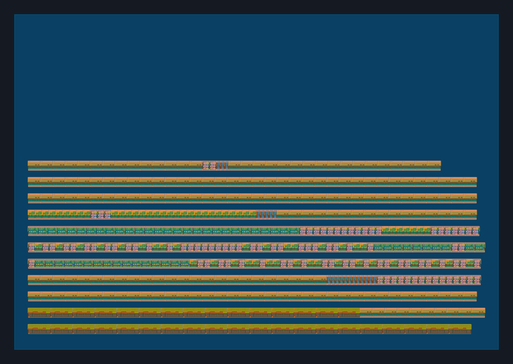
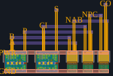

<<<<<<< HEAD
# TinyCalc-TT · 最小 tile 目标整数计算器

目标：在 Tiny Tapeout SKY130 的一个数字 tile 内实现可实际计算的加减乘除芯片。
采用标准单元布局与人工约束的版图路线，优先节约面积。

**当前是逻辑已验证、物理实现未完成的工程检查点，不能直接下单流片。**
完整芯片的手工布线尚未完成；“最小面积”是优化目标，尚未获得全局最优证明。

## 当前可复核的成果

- 两个无符号 8 位输入，16 位结果；加、减、乘、整数除法。
- 复用同一个加减法数据通路，乘除采用多周期计算，没有组合乘法器或除法器。
- 由实际综合逻辑门生成 C++ 仿真器，穷举 **262,144** 组运算输入全部通过。
- 暂停和计算途中复位测试通过。报告在 `reports/verification.txt`。
- 469 个 SKY130 标准单元，单元几何面积约 **4,446.765 μm²**。
- 完整计算器的实际标准单元 GDS 布局检查点、可编辑坐标表和连接清单。
- 一个另外绘制的全加器实验块：人工指定五个单元的位置与八条信号轨道。





## 文件说明

| 文件 | 内容 |
| --- | --- |
| `src/project.v` | Tiny Tapeout 顶层及计算器 RTL |
| `docs/info.md` | 同步接口、引脚、计算语义、时序和边界行为 |
| `docs/physical_status.md` | 已完成项与待完成物理工作 |
| `layout/placement.csv` | 初始行布局坐标表，可逐单元手工修改 |
| `layout/calculator_placement_ONLY.gds` | 真实 SKY130 单元几何，**未布线** |
| `layout/full_adder_EXPERIMENTAL.gds` | 手工指定线路的独立全加器实验块 |
| `layout/full_adder_routes.json` | 全加器网络与走线轨道清单 |
| `layout/mapped_connections.json` | 计算器标准单元连接关系 |
| `layout/status.json` | 面积和物理验证状态，不作成功伪报 |
| `third_party/sky130_fd_sc_hd` | 使用到的官方标准单元及许可 |

## 运算例子

`123+45=168`，`3-8=-5`（返回 0xfffb），`255*255=65025`，`100/7=14`。
每次重新装载 A/B；减法结果按有符号 16 位解释，其他按无符号解释。
除零返回 0xffff 并置错误位。键盘、十进制解析与显示由外部控制器完成；
所有算术运算在本设计硬件完成，外部 ESP32 不代算。

为减少接口逻辑，本版使用 8 位数据总线和同步选通信号，而非 UART/SPI。
具体引脚见 `docs/info.md`。这不是 CPU，没有软件程序或操作系统。

## 复现

安装 Python、g++ 和 Yosys（也可以 `pip install -r requirements-layout.txt` 使用 YoWASP）。

```sh
mkdir -p build
yosys -s scripts/synth.ys > build/synth.log
python scripts/gate_test.py
python scripts/manual_layout.py --cells third_party/sky130_fd_sc_hd
```

YoWASP 替代原生 Yosys 时，第一条综合命令改为：

```sh
python scripts/run_yosys.py -s scripts/synth.ys
```

版图脚本读取固定坐标表，不调用自动布局布线工具。第一次坐标表由脚本按行初始化，
不应描述成已逐单元手工优化。全加器是独立实验，不是计算器已经布线完成的证据。
可以用 KLayout 打开两个 GDS；完整供电、时钟、信号、DRC/LVS/STA 仍待完成。

## GitHub 与制造流程

工程基于 TinyTapeout/ttsky-verilog-template，保留 Apache-2.0 许可与原始历史。
根目录格式、工作流说明和首次运行步骤见 [GitHub 设置说明](docs/github_setup.md)。
自带官方自动 GDS workflow 作为**对照实现**，不代替手工版图验证。
未创建远程仓库、未运行 GitHub Actions、未提交设计、未购买制造服务。
本地首次工程生成于 2026-11-02；实际状态以 `layout/status.json` 为准。

## 来源

- https://github.com/TinyTapeout/ttsky-verilog-template
- https://github.com/google/skywater-pdk-libs-sky130_fd_sc_hd
- https://tinytapeout.com/guides/local-hardening/
- https://tinytapeout.com/faq/

工艺与制造规则必须使用所选批次指定的 PDK 与官方 pin template；当前几何目标边界需再核实。
=======
# TinyCalc-TT · 参考形象 VGA 显示芯片

项目已从计算器改为显示参考图中的圆头、绿色眼睛、大肚子、双手抱肚的黄色角色。
仓库名 `TinyCalc-TT` 保留不变。现在的电路是专用图形显示器，没有 CPU 指令集。


显示素材按用户提供的参考图重新制作；不是上一版正面、小身体、张嘴的简化图案。
`assets/character_source.png` 为按参考形象生成的项目素材，`preview/sprite.png`
为**真正写入硬件 ROM 的像素与色彩**；不是把高分辨率效果图当作芯片画面。

## 已实现

- 48×96 像素图案，4 位索引、16 项调色板，固定数据共 18,432 bits。
- 内部常量 ROM 生成像素，不需要 ESP32、外部图片存储器或电脑实时传图。
- 640×480 VGA，25.175 MHz 像素时钟，约 59.94 Hz，TinyVGA 标准引脚。
- 4 倍整数放大，角色显示尺寸 192×384，默认位置 (224,48)，白色背景。
- 默认上下轻微摆动；`ui_in[0]=1` 暂停动画。保留参考图的闭嘴表情，无眨眼变形。

## 可复核的验证

`reports/video_verification.txt` 记录综合后通用逻辑门仿真结果：

1. 连续 840,000 个像素时钟，检查两帧的计数、同步和 RGB 输出。
2. 在指定相位 0、16、60 分别运行一整帧，对比独立的 `assets/sprite.json`
   图案模型，逐像素检查 ROM 解码、调色板、坐标和缩放。
3. 检查动画冻结、输出禁用和复位。

相位 16/60 直接初始化寄存器进入，不声称连续等待运行了 60 帧。
`preview/animation.gif` 是选定状态的示意串联，播放时长不是硬件真实周期。

## 面积和版图状态

当前配置为 **SKY130，1×2 tiles**。直接映射使用 1,236 个标准单元，
单元面积约 12,931.152 μm²；单个 tile 的占用约 72%，因此给正式布线留出余量。
这不是经过工艺库时序优化后的最优面积，也不证明 1×1 一定放不下。

`layout/nailong_placement_ONLY.gds` 包含当前电路的真实 SKY130 单元几何，
但只是初始行布局，坐标由脚本生成，不是已经逐单元手工优化的完整版图。
完整信号布线、供电、时钟、DRC、LVS 和寄生时序尚未完成。
官方工作流产生的自动硬化版图与这个布局检查点是两个不同实现，不能互相代替验证。

## 外接硬件

Tiny Tapeout 开发板、TinyVGA 电阻 DAC 模块、VGA 线和支持该模式的显示器。
HDMI-only 显示器需要**有源 VGA 输入 → HDMI 输出**转换器。
不能用被动转接线，也不能把芯片数字 RGB 引脚直接连到 VGA 模拟输入。
完整引脚、时序和操作说明见 [docs/info.md](docs/info.md)。

## 复现

```sh
pip install -r requirements-tools.txt
python scripts/encode_sprite.py
mkdir -p build
yowasp-yosys -s scripts/synth.ys > build/synth.log
python scripts/gate_video_test.py
python scripts/preview.py
python scripts/placement_checkpoint.py --cells third_party/sky130_fd_sc_hd
```

综合也可使用原生 `yosys` 或 `python scripts/run_yosys.py`；门级仿真器需要 g++。
传统 RTL 测试用 Icarus Verilog：`pip install -r test/requirements.txt && cd test && make`。
引脚保持 Tiny Tapeout 标准包装，顶层为 `tt_um_skypiggy8_nailong`。
根目录保留 `info.yaml / src / test / docs / .github/workflows` 官方模板结构。

源素材提示词和编码规则见 [assets/PROMPT.md](assets/PROMPT.md)。
本地功能验证通过不等于可制造；以在线 GDS、precheck、门级和时序检查结果为准。
>>>>>>> origin/main
